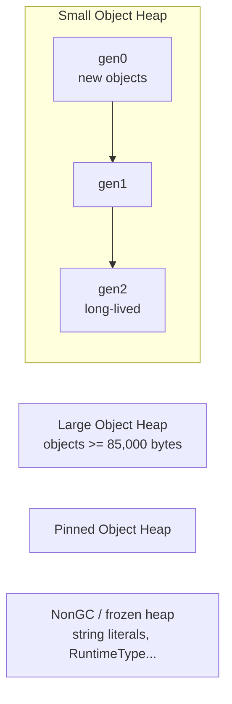
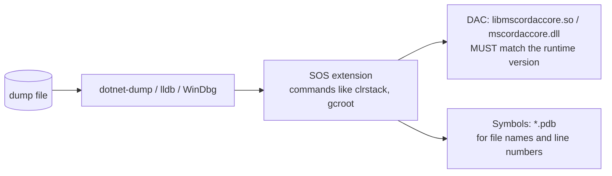

# 1. Dump fundamentals

## What is a dump?

A **dump** (core dump, memory dump) is a file containing a snapshot of a process's memory at one
moment in time: the managed heap with every object, every thread with its stack and registers,
the loaded modules, and runtime data structures such as lock tables.

You do not need the live process anymore once you have the dump. That makes dumps ideal for
production: collect it in seconds, restart the process, analyze at leisure.

A dump answers questions like:

- *What is using all this memory?* - which types, how many, and **who holds a reference to them**.
- *Why is the app not responding?* - what every thread is doing, which locks are held and by whom.
- *Why did it crash?* - the exception, the thread that threw it, the call stack.

A dump does **not** tell you how the process got there. It is a photo, not a video. For "how did we
get here" you need logs, metrics and traces - or several dumps taken over time.

## Dumps vs. the other diagnostic tools

| Tool | Captures | Size | Pauses the app? | Use for |
|---|---|---|---|---|
| `dotnet-dump` | full process memory snapshot | 100 MB - several GB | **yes**, while writing | leaks, hangs, deadlocks, crashes - root cause |
| `dotnet-gcdump` | managed heap *graph* only (types, references) | a few MB | yes, runs a **full GC** | quick memory leak triage |
| `dotnet-counters` | live metrics (GC heap size, thread pool, exceptions) | n/a | no | *Is* there a problem? Watching trends |
| `dotnet-trace` | events over time (CPU samples, GC, exceptions) | MBs | no (small overhead) | slow code, CPU, allocations over time |

The usual workflow is: **counters** tell you *that* something is wrong, a **dump** tells you *why*.

## Dump types

`dotnet-dump collect --type` and `DOTNET_DbgMiniDumpType` accept these types
([MS docs](https://learn.microsoft.com/en-us/dotnet/core/diagnostics/collect-dumps-crash#types-of-mini-dumps)):

| Value | Type | Contains | Good for |
|---|---|---|---|
| 1 | `Mini` | module list, thread list, exception information, all stacks | crash call stacks only |
| 2 | `Heap` | `Mini` + all memory except mapped images | **managed leaks and hangs** - usually enough |
| 3 | `Triage` | `Mini` with personal info (paths, passwords) removed | sharing with third parties |
| 4 | `Full` | all memory including module images | everything, including native analysis |

`dotnet-dump collect` defaults to `Full`. In the labs, a freshly started ASP.NET Core API produced a
**272 MB** `Full` dump and a **153 MB** `Heap` dump on Linux. `Heap` contains everything SOS needs
for managed analysis, so it is usually the better choice in production.

!!! note
    Only `Full` dumps are supported for single-file and Native AOT apps.

## What lives in the managed heap

To read heap output you need a mental model of the .NET GC heap:

- **Generations 0/1/2** - new objects start in gen0; survivors get promoted. A leak always ends up
  in **gen2**, because leaked objects survive every collection.
- **LOH** - objects of 85,000 bytes or more (typically big arrays). Collected only with gen2 and
  **not compacted** by default, so it can fragment ([Lab 1, scenario 4](04-lab-memory-leak.md#scenario-4-large-object-heap-fragmentation)).
- **POH** - pinned objects; the runtime also uses it for its own tables (e.g. static field storage).
- **Free** - `dumpheap -stat` shows a pseudo-type `Free`: gaps between live objects.

## GC roots: why an object is alive

The GC keeps an object alive if it is reachable from a **root**:

| Root kind | Example |
|---|---|
| Stack | a local variable or argument of a method that is currently running |
| Static field | `static List<Order> _cache` - lives as long as the type, i.e. forever |
| GC handle | strong/pinned handles held by the runtime or libraries (timers, sockets, `GCHandle.Alloc`) |
| Finalizer queue | objects waiting for their finalizer to run |

**A memory leak in .NET is almost always "an object stays reachable from a root longer than you
intended."** The heart of leak analysis is therefore: find what grows, then find the root path that
keeps it alive. The SOS command for that is `gcroot` - with an important caveat for static fields
on .NET 10 that you will meet in Lab 1.

## Threads, locks and async

- Every managed thread has a stack of frames. `clrstack` shows them, with source lines if symbols
  are available.
- `lock (obj)` uses `System.Threading.Monitor`. When a lock is contended, the runtime records the
  owner in a **sync block**; `syncblk` lists them. (C# 13's `System.Threading.Lock` does not use
  sync blocks.)
- `async` methods that are *waiting* are **not on any thread**. They are state machine objects on
  the heap, linked by continuations. A thread dump cannot show them; `dumpasync` reconstructs
  these "async stacks" from the heap.

## How the debugger understands the runtime: DAC, SOS, symbols

- **SOS** is the debugger extension that understands .NET. `dotnet-dump analyze` has it built in.
- The **DAC** (Data Access Component) is shipped with each runtime version and knows how to read
  that version's internal data structures. The tool must find the DAC that matches the runtime in
  the dump - usually automatic (from the runtime folder or Microsoft's symbol server).
- **PDBs** map code addresses to source files and lines. Without them you still get method names,
  but no line numbers ([Lab 3](06-lab-crash.md#symbols-get-line-numbers) shows the difference).

The `tools` image in this repo uses the same .NET runtime version as the lab images and contains
the labs' PDBs in `/symbols`, so all of this just works in the labs.

## Security: dumps are sensitive data

A dump contains **everything** that was in memory: connection strings, JWTs, API keys, customer
records, request bodies. Rules of thumb:

- store dumps only where production data is allowed to live, with access control;
- never attach them to public bug reports or commit them to git;
- prefer `Triage` dumps when you have to share them outside your team;
- delete them when the investigation is over.

Next: [Collecting dumps](02-collecting-dumps.md).
