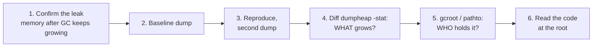

# 4. Lab 1 - Memory leaks

**App:** [`labs/MemoryLeak.Api`](https://github.com/haison8x/net-dump-tutorials/tree/main/labs/MemoryLeak.Api) - an ASP.NET Core API with four leaks.
Every endpoint has a buggy default and a fixed variant (`?fixed=true`).

| Scenario | Endpoint | Leak |
|---|---|---|
| 1 | `/leak/event` | object subscribes to a **static event** and never unsubscribes |
| 2 | `/leak/cache` | **unbounded static cache** keyed by request id |
| 3 | `/leak/timer` | `System.Threading.Timer` that is **never disposed** |
| 4 | `/leak/loh` | **Large Object Heap** churn and fragmentation |

Helper endpoints: `/stats` (memory statistics as JSON) and `/gc` (forces a full, compacting GC).

## The method



The two questions are always the same: **what** grows, and **who** keeps it alive.

---

## Scenario 1: static event handler

### Reproduce

Start a fresh API and take a **baseline** dump before generating load:

```bash
docker compose up -d --force-recreate memoryleak
docker compose exec memoryleak dotnet-dump collect -p 1 -o /dumps/leak-event-1.dmp
```

Generate 4,000 requests (200 req/s for 20 s):

```bash
docker compose run --rm loadgen -c 10 -r 200 -d 20 http://memoryleak:8080/leak/event
```
```text
[00:19] ok=   3991 failed=    0 timeout=    0 in-flight=   0 rps=  180 avg=    2ms
LoadGen finished.
```

### Observe the symptom

Force a GC, then look at the statistics. If memory is still high **after a full GC**, the objects
are not garbage - something references them.

```bash
curl http://localhost:5100/gc
curl http://localhost:5100/stats
```
```text
Full GC done. Managed heap: 64 MB
{"managedHeapMB":64,"heapSizeMB":64,"fragmentedMB":0,"gen0Collections":8,"gen1Collections":4,"gen2Collections":3,"eventSubscribers":3991,...}
```

64 MB after 4,000 requests, and it never goes down. In real life you would see this in
`dotnet-counters monitor -p 1` as `dotnet.gc.last_collection.heap.size` climbing after every GC.

Take the second dump:

```bash
docker compose exec memoryleak dotnet-dump collect -p 1 -o /dumps/leak-event-2.dmp
```

### What grows? Compare `dumpheap -stat`

```bash
docker compose run --rm tools dotnet-dump analyze /dumps/leak-event-1.dmp -c "dumpheap -stat" -c exit
docker compose run --rm tools dotnet-dump analyze /dumps/leak-event-2.dmp -c "dumpheap -stat" -c exit
```

Baseline (bottom of the output - the largest types):

```text
718399efb158   380   120,964 System.Int32[]
718399efdd58 2,767   228,800 System.String
71839ab73d00   414   431,718 System.Byte[]
Total 26,884 objects, 2,388,290 bytes
```

After the load:

```text
5adcf47b1830    18    151,152 Free
71839d8c76c0 3,991    191,568 MemoryLeak.Api.Scenarios.PriceAlertSubscriber
71839d6cf0c0 3,992    255,488 System.EventHandler<System.Decimal>
718399efdd58 5,894    559,246 System.String
71839ab73d00 4,305 65,564,928 System.Byte[]
Total 29,879 objects, 67,677,748 bytes
```

Reading it:

- `System.Byte[]` is the biggest by far (65 MB) - but **byte arrays are never the root cause**,
  they are owned by something.
- `PriceAlertSubscriber`: **3,991** instances - exactly the number of requests. Our own type.
- `EventHandler<Decimal>`: 3,992 - one delegate per subscriber (+1).
- Same count for three types = they belong together. The suspect is `PriceAlertSubscriber`.

!!! tip "Let a tool do the diff"
    [DumpAnalyzer](08-automation-clrmd-dumplinq.md) compares two dumps for you:
    ```bash
    docker compose run --rm tools dumpanalyzer diff /dumps/leak-event-1.dmp /dumps/leak-event-2.dmp 6
    ```
    ```text
          +Count           +Bytes    Count now  Type
          +3,891      +65,133,210        4,305  System.Byte[]
          +3,127         +330,446        5,894  System.String
          +3,952         +252,928        3,992  System.EventHandler<System.Decimal>
          +3,971         +190,608        3,991  MemoryLeak.Api.Scenarios.PriceAlertSubscriber
             -19          +31,312            1  System.Delegate[]
            -105          +23,368          231  System.Object[]
    ```

### Look at one instance

Open the dump interactively - the rest of this scenario runs inside the SOS prompt:

```bash
docker compose run --rm tools dotnet-dump analyze /dumps/leak-event-2.dmp
```

```text
> dumpheap -type PriceAlertSubscriber
         Address               MT           Size
    7143a40cae98     71839d8c76c0             48
    7143a40cb8d8     71839d8c76c0             48
    7143a40cd3f0     71839d8c76c0             48
    ...
Statistics:
          MT Count TotalSize Class Name
71839d8c76c0 3,991   191,568 MemoryLeak.Api.Scenarios.PriceAlertSubscriber
Total 3,991 objects, 191,568 bytes

> dumpobj 7143a946d820
Name:        MemoryLeak.Api.Scenarios.PriceAlertSubscriber
MethodTable: 000071839d8c76c0
Size:        48(0x30) bytes
File:        /app/MemoryLeak.Api.dll
Fields:
              MT    Field   Offset                 Type   VT     Attr            Value Name
000071839ab73d00 04000011        8        System.Byte[]   No instance 00007143a94719c8 _history
0000718399efdd58 04000012       10        System.String   No instance 00007143a946d7c0 _userId
0000718399fb4f68 04000013       18       System.Decimal  Yes instance 00007143a946d838 _lastPrice
```

Each subscriber owns a 16 KB `_history` buffer - that explains the `byte[]` growth.

!!! tip "Pick an object from the middle"
    The first objects in the list are often leftovers from startup or warm-up. Pick one from the
    middle of the list - it is almost certainly part of the leak.

### Who holds it? `gcroot`

```text
> gcroot 7143a946d820
Caching GC roots, this may take a while.
Subsequent runs of this command will be faster.

Found 0 unique roots.
```

**Zero roots - but it survived a full GC.** This is the .NET 10 caveat from
[Chapter 3](03-sos-essentials.md#caveats-learned-the-hard-way): `gcroot` searches stacks, GC
handles and the finalizer queue, and in our tests it did not report roots that go through a
**static field**. A leak through a static is exactly what we have here, so we need another way.

### When `gcroot` finds nothing: static fields

Think about the evidence: one `EventHandler<Decimal>` per subscriber means the subscribers are in an
event's invocation list. Events are fields - and an event that outlives requests is usually
`static`. Find the type that declares the event and read its static fields:

```text
> name2ee MemoryLeak.Api!MemoryLeak.Api.Scenarios.PriceTicker
Module:      0000718399fc1a30
Assembly:    MemoryLeak.Api.dll
Token:       0000000002000007
MethodTable: 000071839d549078
Name:        MemoryLeak.Api.Scenarios.PriceTicker

> dumpclass 000071839d549078
...
NumStaticFields:     1
              MT    Field   Offset                 Type   VT     Attr            Value Name
000071839d6cf0c0 04000010        8 ...Private.CoreLib]]   No   static 00007143a740d450 PriceChanged
```

The static field `PriceChanged` points to a delegate. Confirm it is the path to our subscriber:

```text
> pathto 00007143a740d450 7143a946d820
          -> 7143a740d450     System.EventHandler<System.Decimal>
          -> 7143aa164cc8     System.Object[]
          -> 7143a947daa0     System.EventHandler<System.Decimal>
          -> 7143a946d820     MemoryLeak.Api.Scenarios.PriceAlertSubscriber

> dumpobj 00007143a740d450
Name:        System.EventHandler`1[[System.Decimal, System.Private.CoreLib]]
...
0000718398ed47b0 0400025e       28        System.Object   No instance 00007143aa164cc8 _invocationList
0000718399ef73b0 0400025f       30        System.IntPtr  Yes instance 0000000000000F97 _invocationCount
```

`_invocationCount` = 0xF97 = **3,991 subscribers**. The full root chain is:

```text
static PriceTicker.PriceChanged
  -> EventHandler<decimal>         (the multicast delegate)
     -> object[] _invocationList   (one entry per subscriber)
        -> EventHandler<decimal>   (one subscriber's delegate)
           -> PriceAlertSubscriber (the delegate's _target)
              -> byte[16384]       (_history)
```

!!! tip "DumpAnalyzer finds the static for you"
    `dumpanalyzer roots` (ClrMD) falls back to walking from every static field when no root is
    reported, and names the field:
    ```bash
    docker compose run --rm tools dumpanalyzer roots /dumps/leak-event-2.dmp PriceAlertSubscriber
    ```
    ```text
    3,991 instance(s) of *PriceAlertSubscriber on the heap (live + dead).

    Root path for 00007143a94553d0 MemoryLeak.Api.Scenarios.PriceAlertSubscriber:
      ROOT: static field MemoryLeak.Api.Scenarios.PriceTicker.PriceChanged (found by walking from static fields)
        -> 00007143a740d450 System.EventHandler<System.Decimal>
        -> 00007143aa164cc8 System.Object[]
        -> 00007143a9469588 System.EventHandler<System.Decimal>
        -> 00007143a94553d0 MemoryLeak.Api.Scenarios.PriceAlertSubscriber
    ```

### Root cause

[`Scenarios/EventLeak.cs`](https://github.com/haison8x/net-dump-tutorials/blob/main/labs/MemoryLeak.Api/Scenarios/EventLeak.cs):

```csharp
public PriceAlertSubscriber(string userId)
{
    _userId = userId;
    PriceTicker.PriceChanged += OnPriceChanged;   // static event now references `this`
}

// BUG: the subscriber is never disposed, so it stays subscribed forever.
var leaky = new PriceAlertSubscriber($"user-{Guid.NewGuid():N}");
```

`OnPriceChanged` is an instance method, so the delegate stored in the **static** event holds a
reference to the subscriber. The subscriber can never be collected.

### Fix and verify

```csharp
// FIX: unsubscribe when the subscriber's lifetime ends.
using var subscriber = new PriceAlertSubscriber($"user-{Guid.NewGuid():N}");

public void Dispose() => PriceTicker.PriceChanged -= OnPriceChanged;
```

```bash
docker compose up -d --force-recreate memoryleak
docker compose run --rm loadgen -c 10 -r 200 -d 20 "http://memoryleak:8080/leak/event?fixed=true"
curl http://localhost:5100/gc
```
```text
Full GC done. Managed heap: 0 MB
```

Other common shapes of the same bug: subscribing to an event of a **singleton** service
(`IOptionsMonitor.OnChange`, a message bus, `AppDomain.CurrentDomain.*` events), and lambdas that
capture `this` in such subscriptions.

---

## Scenario 2: unbounded static cache

### Reproduce and find what grows

```bash
docker compose up -d --force-recreate memoryleak
docker compose exec memoryleak dotnet-dump collect -p 1 -o /dumps/leak-cache-1.dmp
docker compose run --rm loadgen -c 10 -r 200 -d 20 http://memoryleak:8080/leak/cache
curl http://localhost:5100/gc        # Full GC done. Managed heap: 79 MB
docker compose exec memoryleak dotnet-dump collect -p 1 -o /dumps/leak-cache-2.dmp
docker compose run --rm tools dumpanalyzer diff /dumps/leak-cache-1.dmp /dumps/leak-cache-2.dmp 5
```
```text
      +Count           +Bytes    Count now  Type
      +7,975      +80,874,618        9,954  System.String
         +16         +266,624           38  System.Char[]
      +4,000         +224,000        4,020  MemoryLeak.Api.Scenarios.CustomerReport
      +4,000         +224,000        4,000  System.Collections.Concurrent.ConcurrentDictionary<System.Guid, MemoryLeak.Api.Scenarios.CustomerReport>+Node
           0         +139,856            1  System.Collections.Concurrent.ConcurrentDictionary<System.Guid, MemoryLeak.Api.Scenarios.CustomerReport>+VolatileNode[]
```

80 MB of strings, and 4,000 `CustomerReport` objects sitting in `ConcurrentDictionary` nodes - the
type names already tell the story. A `+Node` count that only grows is the signature of a
dictionary used as a cache without eviction.

### Who holds it?

`gcroot` again reports `Found 0 unique roots.` (the dictionary is in a static field), so use the
same technique:

```text
> name2ee MemoryLeak.Api!MemoryLeak.Api.Scenarios.ReportCache
MethodTable: 00007d3865b99728
> dumpclass 00007d3865b99728
...
00007d3865d40018 0400000f        8 ... MemoryLeak.Api]]   No   static 00007cf86c0b82b0 _reports

> pathto 00007cf86c0b82b0 <a CustomerReport address>
          -> 7cf86c0b82b0     System.Collections.Concurrent.ConcurrentDictionary<System.Guid, MemoryLeak.Api.Scenarios.CustomerReport>
          -> 7cf86ea80318     System.Collections.Concurrent.ConcurrentDictionary<...>+Tables
          -> 7cf878000048     System.Collections.Concurrent.ConcurrentDictionary<...>+VolatileNode[]
          -> 7cf86ea86f98     System.Collections.Concurrent.ConcurrentDictionary<...>+Node
          ...
```

`dumpconcurrentdictionary` (`dcd`) lists the entries - useful to see *what* is being cached:

```text
> dcd 00007cf86c0b82b0
System.Collections.Concurrent.ConcurrentDictionary<System.Guid, MemoryLeak.Api.Scenarios.CustomerReport>
    -----
      Key: dumpvc 00007d38625f7940 00007cf86eaa48a4
    Value: dumpobj 00007cf87022feb8
    -----
      Key: dumpvc 00007d38625f7940 00007cf86ea859d4
    Value: dumpobj 00007cf870a842d0
...
```

A ClrMD query ([Chapter 8](08-automation-clrmd-dumplinq.md)) summarizes it in one go:

```text
CustomerReport instances: 4,020
Bytes held by reports + their HTML strings: 81,340,680
Distinct customers: 4,020  <- every entry is unique: the cache never hits
ReportCache._reports = 00007cf86c0b82b0 (System.Collections.Concurrent.ConcurrentDictionary<System.Guid, MemoryLeak.Api.Scenarios.CustomerReport>)
```

### Root cause and fix

[`Scenarios/CacheLeak.cs`](https://github.com/haison8x/net-dump-tutorials/blob/main/labs/MemoryLeak.Api/Scenarios/CacheLeak.cs):
a `static ConcurrentDictionary` with no size limit and no expiration, keyed by a value that is
different on every request - so the cache only ever grows and never hits.

The fix uses a bounded `IMemoryCache` (`SizeLimit = 1_000` entries, sliding expiration):

```csharp
var report = cache.GetOrCreate(reportId, entry =>
{
    entry.Size = 1;
    entry.SlidingExpiration = TimeSpan.FromSeconds(30);
    return BuildReport(reportId);
})!;
```

With `?fixed=true` the heap after GC stays at **20 MB** - the 1,000 entries the cache is allowed to
keep - no matter how long the load runs.

---

## Scenario 3: undisposed timer

### What grows

```bash
docker compose run --rm tools dumpanalyzer diff /dumps/leak-timer-1.dmp /dumps/leak-timer-2.dmp 10
```
```text
      +Count           +Bytes    Count now  Type
      +3,899     +130,489,141        4,314  System.Byte[]
      +3,981         +796,200        4,002  System.Diagnostics.Activity
     +11,193         +775,634       13,923  System.String
      +3,980         +382,080        4,000  System.Threading.TimerQueueTimer
      +3,980         +254,720        4,000  System.Threading.TimerCallback
      +3,972         +190,656        4,014  Microsoft.Extensions.Logging.LoggerFactoryScopeProvider+Scope
      +3,961         +190,128        4,003  System.Threading.AsyncLocalValueMap+TwoElementAsyncLocalValueMap
      +3,981         +159,240        4,002  Microsoft.AspNetCore.Hosting.HostingApplicationDiagnostics+Log+HostingLogScope
      +3,980         +159,200        4,000  MemoryLeak.Api.Scenarios.ReportPoller
      +3,904         +156,160        4,010  System.Threading.ExecutionContext
```

4,000 `ReportPoller`s and 4,000 `TimerQueueTimer`s. But look at the rest: **`Activity`,
`HostingLogScope`, `ExecutionContext`** - 4,000 of each. Those are per-*request* objects. Why are
4,000 finished requests still in memory?

Because a `Timer` **captures the `ExecutionContext`** (all `AsyncLocal` values) of the code that
created it. Our timer was created during a request, so it keeps that request's `Activity` and
logging scopes alive too. A leaked timer leaks more than you think.

### Who holds it?

This time `gcroot` works - the root is not a static field but the stack of the runtime's timer
thread:

```text
> gcroot 768c8c314e80
Thread 29:
    768b6affcb80 76cc7e6408c0 System.Threading.TimerQueue.TimerThread()
        rbp-70: 0000768b6affcb90
          -> 768c884c7328     System.Collections.Generic.List<System.Threading.TimerQueue>
          -> 768c884c7348     System.Threading.TimerQueue[]
          -> 768c884c6ff8     System.Threading.TimerQueue
          -> 768c8bc08728     System.Threading.TimerQueueTimer
          -> 768c88f26c48     System.Threading.TimerQueueTimer
          ...                 (a long linked list of TimerQueueTimer)
          -> 768c8c3355f0     System.Threading.TimerQueueTimer
          -> 768c8c335598     System.Threading.TimerCallback
          -> 768c8c314e80     MemoryLeak.Api.Scenarios.ReportPoller

Found 1 unique roots.
```

`timerinfo` lists every active timer - 4,000 of them, all firing every second into the same callback:

```text
> timerinfo
(S) 0x0000768C8B2A8F98 @     999 ms every     1000 ms |  0000000000000000 () -> MemoryLeak.Api.Scenarios.ReportPoller.<.ctor>b__3_0
(S) 0x0000768C885E7180 @     994 ms every     1000 ms |  0000000000000000 () -> MemoryLeak.Api.Scenarios.ReportPoller.<.ctor>b__3_0
...
   4000 timers
```

### Root cause and fix

[`Scenarios/TimerLeak.cs`](https://github.com/haison8x/net-dump-tutorials/blob/main/labs/MemoryLeak.Api/Scenarios/TimerLeak.cs):

```csharp
_timer = new Timer(_ => Poll(), null, TimeSpan.FromSeconds(1), TimeSpan.FromSeconds(1));
...
_ = new ReportPoller();          // BUG: "fire and forget" - nobody ever calls Dispose()
```

A scheduled timer is referenced by the runtime's timer queue; its callback references the
`ReportPoller`. A periodic timer never "finishes", so without `Dispose()` it lives forever. Fix:
dispose the timer (here: `using var poller = new ReportPoller();`). With `?fixed=true` the heap
after GC is back to 0 MB.

!!! tip "Not only `System.Threading.Timer`"
    The same pattern applies to `PeriodicTimer` loops that are never cancelled,
    `System.Timers.Timer`, and `CancellationToken.Register` callbacks on long-lived tokens.

---

## Scenario 4: Large Object Heap fragmentation

Objects of **85,000 bytes or more** go to the LOH. It is collected only with gen2 and not compacted
by default, so allocating many large buffers - and keeping some of them - leaves holes.

```bash
docker compose run --rm loadgen -c 10 -r 200 -d 20 http://memoryleak:8080/leak/loh
curl http://localhost:5100/gc
curl http://localhost:5100/stats
```
```text
Full GC done. Managed heap: 239 MB
{"managedHeapMB":239,"heapSizeMB":282,"fragmentedMB":42,...,"retainedUploads":1998}
```

```text
> gcheapstat
Heap     Gen0       Gen1       Gen2       LOH        POH        FRZ
Heap0    69568      117472     879688     294815840  132696
Total    69568      117472     879688     294815840  132696

Free space:
Heap     Gen0       Gen1       Gen2       LOH        POH        FRZ
Heap0    120        109152     232        44266192   53560      SOH:10%    LOH:15%  POH:40%
Total    120        109152     232        44266192   53560

> dumpheap -stat -min 85000
Statistics:
          MT Count   TotalSize Class Name
5d5a4fd18830   258  38,028,160 Free
7ffb69f33d00 2,006 250,542,639 System.Byte[]
Total 2,264 objects, 288,570,799 bytes
```

- **LOH: 295 MB**, of which **44 MB (15%) is free space** - holes the GC cannot easily reuse.
- 2,006 large `byte[]` are alive, and 258 large `Free` blocks sit between them.

The code ([`Scenarios/LohFragmentation.cs`](https://github.com/haison8x/net-dump-tutorials/blob/main/labs/MemoryLeak.Api/Scenarios/LohFragmentation.cs))
allocates a new 100-150 KB buffer per request and keeps every second one in a static list. The fix
rents buffers from `ArrayPool<byte>.Shared` and does not keep them after the request - heap after GC: **4 MB**.

Use `gcroot` / `pathto` on one of the arrays as in scenario 1 to find the list that retains them.

---

## Summary

| Scenario | What grows | Who holds it | How we found the root |
|---|---|---|---|
| Static event | `PriceAlertSubscriber`, `EventHandler<T>` | `static PriceTicker.PriceChanged` | `dumpclass` + `pathto` (gcroot: 0 roots) |
| Static cache | `CustomerReport`, `ConcurrentDictionary+Node` | `static ReportCache._reports` | `dumpclass` + `pathto`, `dcd` |
| Timer | `ReportPoller`, `TimerQueueTimer`, *+ request objects* | runtime `TimerQueue` | `gcroot`, `timerinfo` |
| LOH | `byte[]` >= 85 KB, `Free` | static list | `gcheapstat`, `dumpheap -min` |

## Try it yourself

1. Run `/leak/event` and `/leak/cache` **together** (two URLs in one `loadgen` command). Can you
   still separate the two leaks in a single `dumpheap -stat`?
2. Collect a `dotnet-gcdump` of the timer leak and open it with `dotnet-gcdump report`. What can
   and can't you see compared with the full dump?
3. Collect the timer leak dump with `--type Heap` instead of `Full`. Compare the file sizes. Do all
   the commands above still work?

## Further reading

- [Debug a memory leak tutorial (Microsoft)](https://learn.microsoft.com/en-us/dotnet/core/diagnostics/debug-memory-leak)
- [C# Corner: Find memory leaks in .NET application using dump file](https://www.c-sharpcorner.com/blogs/find-memory-leaks-in-net-application-using-dump-file)
- [Bacancy: dotnet-dump analysis](https://www.bacancytechnology.com/qanda/dot-net/dotnet-dump-analysis)

Next: [Lab 2 - Deadlocks and hangs](05-lab-deadlock.md).
