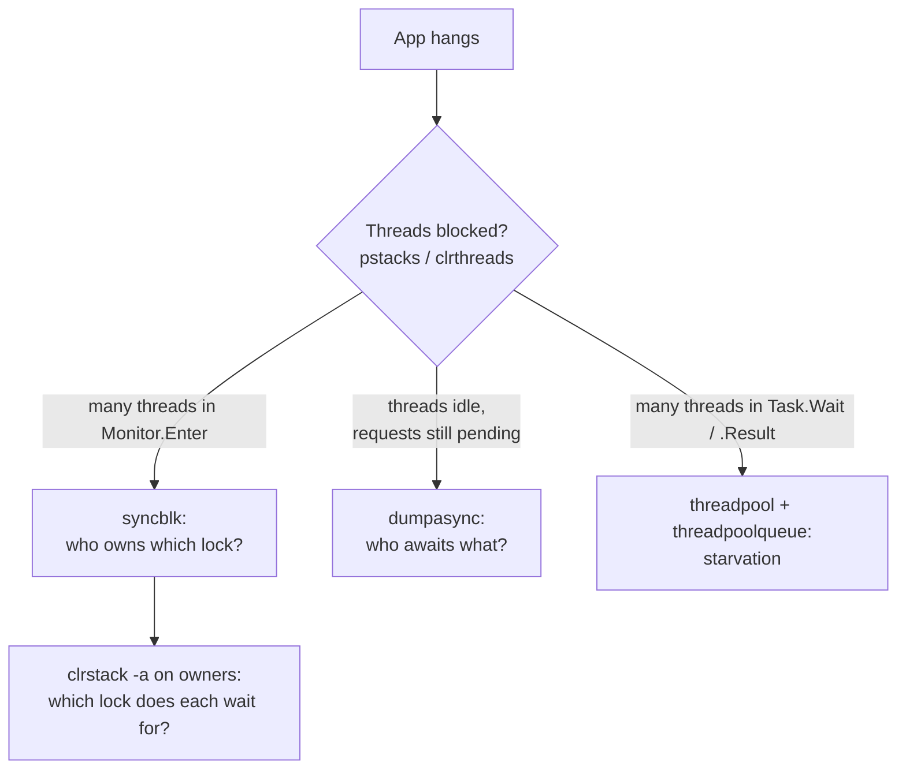
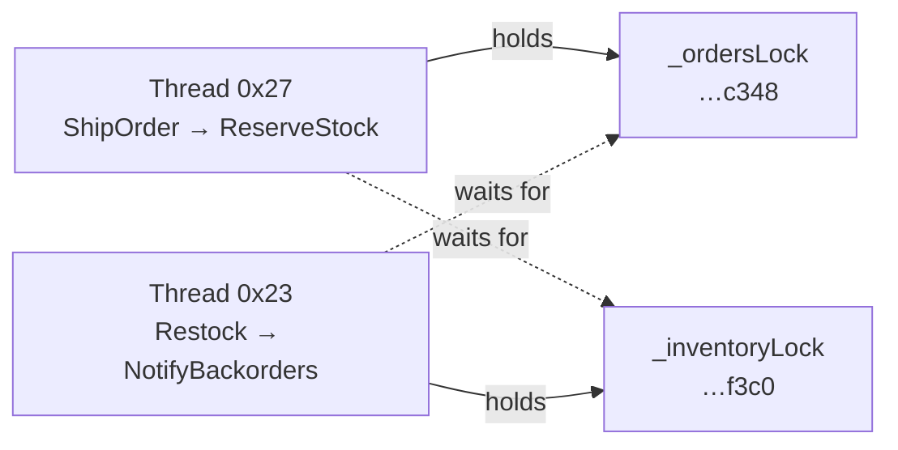
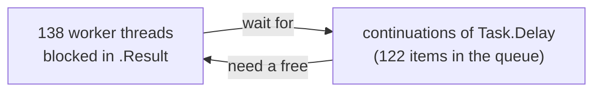

# 5. Lab 2 - Deadlocks and hangs

**App:** [`labs/Deadlock.Api`](https://github.com/haison8x/net-dump-tutorials/tree/main/labs/Deadlock.Api) - an ASP.NET Core API that hangs in three different ways.

| Scenario | Endpoint(s) | Hang |
|---|---|---|
| 1 | `/orders/ship` + `/inventory/restock` | classic **lock-ordering deadlock** (`lock` / `Monitor`) |
| 2a | `/config/refresh` | **async re-entrancy** deadlock on `SemaphoreSlim` |
| 2b | `/token` | **orphaned** `SemaphoreSlim` - never released after an exception |
| 3 | `/starvation` | **sync-over-async thread pool starvation** |

`/health` answers instantly as long as the app is healthy.

## The method

A hang dump answers: **what is every thread doing, and what is it waiting for?**



---

## Scenario 1: lock-ordering deadlock

### Reproduce

The two endpoints take the same two locks in **opposite order**. Hit both at the same time:

```bash
docker compose up -d --force-recreate deadlock
docker compose run --rm loadgen -c 4 -d 8 -t 3 http://deadlock:8080/orders/ship http://deadlock:8080/inventory/restock
```
```text
[00:07] ok=      0 failed=    0 timeout=    8 in-flight=   4 rps=    0 avg= 3008ms
```

Zero successful requests, everything times out. Note that `/health` still answers
(`OK threads=15 queued=0`): a lock deadlock freezes only the threads involved - the rest of the app
keeps working, which makes these bugs sneaky in production.

```bash
docker compose exec deadlock dotnet-dump collect -p 1 -o /dumps/deadlock-locks.dmp
docker compose run --rm tools dotnet-dump analyze /dumps/deadlock-locks.dmp
```

### Who owns which lock? `syncblk`

```text
> syncblk
Index         SyncBlock MonitorHeld Recursion Owning Thread Info          SyncBlock Owner
    8 000062E9F35DEDB0           13         1 0000745B90001150 27  32   0000745cb497c348 System.Object
    9 000062E9F35DEE08           13         1 0000745BAC002060 23  28   0000745cb498f3c0 System.Object
-----------------------------
Total           9
Free            0
```

Two locks are held:

| Lock object | Owner (OS thread id / DBG index) |
|---|---|
| `0000745cb497c348` | OS thread `0x27`, debugger thread 32 |
| `0000745cb498f3c0` | OS thread `0x23`, debugger thread 28 |

**MonitorHeld** = 1 for the owner + 2 for each waiting thread: 13 = 1 + 2 x 6, so **6 threads wait**
for each lock.

### What are the owners doing? `clrstack`

Load the lab symbols first so stacks show file and line numbers ([why](06-lab-crash.md#symbols-get-line-numbers)):

```text
> setsymbolserver -directory /symbols
> setthread -t 39          # OS thread id 0x27 = 39 in decimal
> clrstack
OS Thread Id: 0x27 (32)
        Child SP               IP Call Site
0000745B97B7F640 0000749CA9A18B12 System.Threading.Monitor.Enter_Slowpath(System.Object) [/_/src/runtime/src/coreclr/System.Private.CoreLib/src/System/Threading/Monitor.CoreCLR.cs @ 73]
0000745B97B7F6E0 0000749CADFE6C23 System.Threading.Monitor.Enter(System.Object, Boolean ByRef) [...]
0000745B97B7F700 0000749CAE005C8A Deadlock.Api.Scenarios.InventoryService.ReserveStock(Int32) [/src/labs/Deadlock.Api/Scenarios/LockOrdering.cs @ 56]
0000745B97B7F750 0000749CAE00561F Deadlock.Api.Scenarios.OrderService.ShipOrder(Int32) [/src/labs/Deadlock.Api/Scenarios/LockOrdering.cs @ 32]
...
```

```text
> setthread -t 35          # 0x23
> clrstack
OS Thread Id: 0x23 (28)
...
0000745BFE44B4C0 0000749CA9A18B12 System.Threading.Monitor.Enter_Slowpath(System.Object) [...]
0000745BFE44B560 0000749CADFE6C23 System.Threading.Monitor.Enter(System.Object, Boolean ByRef) [...]
0000745BFE44B580 0000749CAE005DB2 Deadlock.Api.Scenarios.OrderService.NotifyBackorders(Int32) [/src/labs/Deadlock.Api/Scenarios/LockOrdering.cs @ 41]
0000745BFE44B650 0000749CAE005A5E Deadlock.Api.Scenarios.InventoryService.Restock(Int32, Boolean) [/src/labs/Deadlock.Api/Scenarios/LockOrdering.cs @ 88]
0000745BFE44B770 0000749CAE005821 Program+<>c.<<Main>$>b__0_2(System.Nullable`1<Boolean>, Deadlock.Api.Scenarios.InventoryService) [/src/labs/Deadlock.Api/Program.cs @ 30]
```

**Both lock owners are themselves waiting in `Monitor.Enter`.** That is a deadlock.

### Which lock does each one wait for? `clrstack -a`

`-a` prints arguments and locals. The lock object a frame holds or waits for appears as a local:

```text
> setthread -t 39
> clrstack -a
...
0000745B97B7F700 0000749CAE005C8A Deadlock.Api.Scenarios.InventoryService.ReserveStock(Int32) [/src/labs/Deadlock.Api/Scenarios/LockOrdering.cs @ 56]
    PARAMETERS:
        this (0x0000745B97B7F738) = 0x0000745cb498f398
        orderId (0x0000745B97B7F734) = 0x000000000000008c
    LOCALS:
        0x0000745B97B7F728 = 0x0000745cb498f3c0      <-- waiting for this lock
        0x0000745B97B7F720 = 0x0000000000000000      <-- lockTaken = false

0000745B97B7F750 0000749CAE00561F Deadlock.Api.Scenarios.OrderService.ShipOrder(Int32) [/src/labs/Deadlock.Api/Scenarios/LockOrdering.cs @ 32]
    PARAMETERS:
        this (0x0000745B97B7F7C8) = 0x0000745cb497c320
        orderId (0x0000745B97B7F7C4) = 0x000000000000008c
    LOCALS:
        0x0000745B97B7F7B8 = 0x0000745cb497c348      <-- holds this lock
        0x0000745B97B7F7B0 = 0x0000000000000001      <-- lockTaken = true
```

And which fields are those lock objects? `dumpobj` on the two `this` pointers:

```text
> dumpobj 0x0000745cb498f398
Name:        Deadlock.Api.Scenarios.InventoryService
0000749ca97c47b0 04000005       10        System.Object   No instance 0000745cb498f3c0 _inventoryLock
> dumpobj 0x0000745cb497c320
Name:        Deadlock.Api.Scenarios.OrderService
0000749ca97c47b0 04000002       10        System.Object   No instance 0000745cb497c348 _ordersLock
```

The full picture:



### The fast overview: `pstacks`

`pstacks` merges identical stacks, so 14 blocked request threads collapse into a few branches:

```text
> pstacks
...
                          ~~~~ 23
                             1 System.Threading.Monitor.Enter(Object, Boolean ByRef)
                             1 Deadlock.Api.Scenarios.OrderService.NotifyBackorders(Int32)
                          ~~~~ 26
                             1 System.Threading.Monitor.Enter(Object, Boolean ByRef)
                        2 Deadlock.Api.Scenarios.InventoryService.Restock(Int32, Boolean)
                          ~~~~ 27
                             1 System.Threading.Monitor.Enter(Object, Boolean ByRef)
                             1 Deadlock.Api.Scenarios.InventoryService.ReserveStock(Int32)
                          ~~~~ 21,29,2a
                             3 System.Threading.Monitor.Enter(Object, Boolean ByRef)
                        4 Deadlock.Api.Scenarios.OrderService.ShipOrder(Int32)
...
```

Read it bottom-up like a tree: `ShipOrder` callers branch into "waits directly in `Monitor.Enter`"
(waiters for `_ordersLock`) and "went on to `ReserveStock`" (the owner, now waiting for the
other lock). In a real incident, **start with `pstacks`** - it shows you in seconds where the
threads are piling up.

!!! tip "Automated"
    `dumpanalyzer hang` builds the wait-for graph from sync blocks and stack roots and reports cycles:
    ```text
    == Monitor locks (lock statements) ==
      System.Object @ 0000745cb497c348 owned by thread 12 (OS 0x27), 6 waiter(s)
      System.Object @ 0000745cb498f3c0 owned by thread 9 (OS 0x23), 6 waiter(s)
      thread 9 waits for 0000745cb497c348 (owned by thread 12) in Deadlock.Api.Scenarios.OrderService.NotifyBackorders(Int32)
      thread 12 waits for 0000745cb498f3c0 (owned by thread 9) in Deadlock.Api.Scenarios.InventoryService.ReserveStock(Int32)
      ...
      *** DEADLOCK: thread 9 -> thread 12 -> thread 9
    ```
    (thread numbers here are *managed* thread ids, the `ID` column of `clrthreads`.)

### Root cause and fix

[`Scenarios/LockOrdering.cs`](https://github.com/haison8x/net-dump-tutorials/blob/main/labs/Deadlock.Api/Scenarios/LockOrdering.cs):

```text
ShipOrder:  lock(_ordersLock)    → ReserveStock     → lock(_inventoryLock)
Restock:    lock(_inventoryLock) → NotifyBackorders → lock(_ordersLock)
```

Fix: acquire locks in **one global order** everywhere (here: orders, then inventory) - or avoid
calling into another component while holding a lock.

```bash
docker compose up -d --force-recreate deadlock
docker compose run --rm loadgen -c 4 -d 6 -t 3 http://deadlock:8080/orders/ship "http://deadlock:8080/inventory/restock?fixed=true"
```
```text
[00:05] ok=    116 failed=    0 timeout=    0 in-flight=   4 rps=   19 avg=  201ms
```

!!! note "`System.Threading.Lock` is different"
    C# 13 / .NET 9 introduced `System.Threading.Lock`. `lock (myLock)` on a `Lock` instance does
    **not** use `Monitor`, so it does not show up in `syncblk`. The waiting threads are still
    visible in `pstacks`/`clrstack` (in `System.Threading.Lock` frames), and `clrstack -a` plus
    `dumpobj` on the `Lock` objects shows their owner fields. (This lab uses `lock (object)`, so this
    variant was not exercised here.)

---

## Scenario 2: async deadlocks on `SemaphoreSlim`

`SemaphoreSlim.WaitAsync()` is the standard "async lock". When it deadlocks, **no thread is
blocked**: waiting requests are just suspended state machines on the heap. That is why these hangs
confuse people - the thread dump looks perfectly idle.

### Reproduce

```bash
docker compose up -d --force-recreate deadlock
curl -m 3 http://localhost:5200/config/refresh            # 2a: hangs (curl gives up after 3 s)
docker compose run --rm loadgen -c 4 -d 6 -t 3 http://deadlock:8080/token   # 2b
```
```text
[00:05] ok=      4 failed=    1 timeout=    4 in-flight=   4 rps=    0 avg= 1419ms
```

`/token` works 4 times, fails once (`failed=1`) - and then **every** following request hangs.

```bash
curl http://localhost:5200/health
```
```text
OK threads=6 queued=0
```

Only 6 threads, nothing queued, nothing busy - yet requests hang.

```bash
docker compose exec deadlock dotnet-dump collect -p 1 -o /dumps/deadlock-semaphore.dmp
docker compose run --rm tools dotnet-dump analyze /dumps/deadlock-semaphore.dmp
```

`syncblk` is empty and `pstacks` shows only idle infrastructure threads. Time for `dumpasync`.

### Async stacks: `dumpasync`

```text
> dumpasync --coalesce
STACKS 1
[9] 00007914b281f5d0 System.Threading.SemaphoreSlim+TaskNode
  [8] 00007914b28aeae0 (0) Deadlock.Api.Scenarios.TokenService+<GetTokenAsync>d__3
    [8] 00007914b28afea0 (0) Program+<>c+<<<Main>$>b__0_4>d
      [8] ... Microsoft.AspNetCore.Http.RequestDelegateFactory+<ExecuteTaskResult>d__144<...>
        [8] ... Microsoft.AspNetCore.Server.Kestrel.Core.Internal.Http.HttpProtocol+<ProcessRequests>d__236<...>
          ...
  [1] 00007914b281fec8 (0) Deadlock.Api.Scenarios.ConfigService+<GetSettingAsync>d__3
    [1] 00007914b281cd08 (2) Deadlock.Api.Scenarios.ConfigService+<RefreshAsync>d__2
      [1] 00007914b281d9b0 (0) Program+<>c+<<<Main>$>b__0_3>d
        ...
```

Read it top-down: the top line is **what is being awaited** (`SemaphoreSlim+TaskNode` = a pending
`WaitAsync()`), each indented line is the async method awaiting the one above. `[n]` is how many
async stacks share that frame (`--coalesce`), `(n)` is the state machine's state - which `await`
it is suspended at.

Two stories:

- **8 requests** are suspended in `TokenService.GetTokenAsync`, all awaiting a semaphore.
- **1 request** is in `ConfigService.GetSettingAsync`, which was called *by*
  `ConfigService.RefreshAsync` (state 2 = its second `await`), and is waiting for a semaphore.

### Which semaphore, and who holds it?

```text
> dumpheap -type System.Threading.SemaphoreSlim
         Address               MT           Size
    78d4b88874e0     7914b146b6a8             64
    78d4b88f29c8     7914b281f5d0             88
    78d4b89852b8     7914b146b6a8             64
    ...
> dumpobj 78d4b89852b8
Name:        System.Threading.SemaphoreSlim
MethodTable: 00007914b146b6a8
Size:        64(0x40) bytes
File:        /usr/share/dotnet/shared/Microsoft.NETCore.App/10.0.14/System.Private.CoreLib.dll
Fields:
              MT    Field   Offset                 Type   VT     Attr            Value Name
00007914aef774e8 04000ce3       28         System.Int32  Yes instance                0 m_currentCount
00007914aef774e8 04000ce4       2c         System.Int32  Yes instance                1 m_maxCount
00007914aef774e8 04000ce5       30         System.Int32  Yes instance                0 m_waitCount
00007914aef774e8 04000ce6       34         System.Int32  Yes instance                0 m_countOfWaitersPulsedToWake
00007914b146c4b8 04000ce7        8 ...Private.CoreLib]]   No instance 000078d4b89852f8 m_lockObjAndDisposed
00007914b2bdf308 04000ce8       10 ....ManualResetEvent   No instance 0000000000000000 m_waitHandle
00007914b281f5d0 04000ce9       18 ...horeSlim+TaskNode   No instance 000078d4b8986430 m_asyncHead
00007914b281f5d0 04000cea       20 ...horeSlim+TaskNode   No instance 000078d4b8986430 m_asyncTail
```

- `m_maxCount = 1`: it is used as an async lock.
- `m_currentCount = 0`: no permit left - someone holds it.
- `m_waitCount = 0`: no *thread* is blocked in `Wait()`...
- ...but `m_asyncHead` is set: there is a linked list of **async** waiters (`TaskNode`s).

Follow the waiter to the async method that awaits it, with fields:

```text
> dumpasync --address 000078d4b8986488 --fields
STACK 1
000078d4b8986430 00007914b281f5d0 ( ) System.Threading.SemaphoreSlim+TaskNode
  ...
  000078d4b8986488 00007914b281fec8 (0) Deadlock.Api.Scenarios.ConfigService+<GetSettingAsync>d__3
                   Address               MT Type                                        Value Name
          000078d4b89864d8 00007914aef774e8 System.Int32                                    0 <>1__state
          000078d4b8985298 00007914af06b1c8 ...k.Api.Scenarios.ConfigService 000078d4b8985298 <>4__this
          00007915286e23a8 00007914aef9dd58 System.String                          "FeatureX" key
    000078d4b8986018 00007914b281cd08 (2) Deadlock.Api.Scenarios.ConfigService+<RefreshAsync>d__2
                     Address               MT Type                                        Value Name
            000078d4b8986060 00007914aef774e8 System.Int32                                    2 <>1__state
            000078d4b8985298 00007914af06b1c8 ...k.Api.Scenarios.ConfigService 000078d4b8985298 <>4__this
            000078d4b8986064 00007914aef730e0 System.Boolean                              false fixed
```

**The same `ConfigService` instance (`000078d4b8985298`) in both frames.** And its field is our
semaphore:

```text
> dumpobj 000078d4b8985298
Name:        Deadlock.Api.Scenarios.ConfigService
00007914b146b6a8 04000007        8 ...ing.SemaphoreSlim   No instance 000078d4b89852b8 _configGate
```

`RefreshAsync` holds `_configGate` and awaits `GetSettingAsync`, which waits for the same `_configGate`.

**Same `ConfigService` instance in both frames.** `RefreshAsync` holds the service's semaphore and
awaits `GetSettingAsync`, which waits for the same semaphore.

!!! tip "Automated"
    ```bash
    docker compose run --rm tools dotnet run /queries/clrmd-stuck-semaphores.cs -- /dumps/deadlock-semaphore.dmp
    ```
    ```text
    SemaphoreSlim 000078d4b89852b8: currentCount=0, 1 async waiter(s)
          1 x System.Runtime.CompilerServices.AsyncTaskMethodBuilder<System.String>+AsyncStateMachineBox<Deadlock.Api.Scenarios.ConfigService+<GetSettingAsync>d__3>
    SemaphoreSlim 000078d4b898e370: currentCount=0, 8 async waiter(s)
          8 x System.Runtime.CompilerServices.AsyncTaskMethodBuilder<System.String>+AsyncStateMachineBox<Deadlock.Api.Scenarios.TokenService+<GetTokenAsync>d__3>
    ```

### Root causes and fixes

[`Scenarios/SemaphoreDeadlocks.cs`](https://github.com/haison8x/net-dump-tutorials/blob/main/labs/Deadlock.Api/Scenarios/SemaphoreDeadlocks.cs):

**2a - re-entrancy.** `SemaphoreSlim` is *not* re-entrant (unlike `lock`). A method that holds it
must not call another method that acquires it again. Fix: split into a public method that takes
the lock and a private "core" method that assumes it is held.

**2b - orphaned permit.** For the token semaphore, nobody is holding it in any frame: there is no
async stack *inside* the protected region. The permit was taken and never given back:

```csharp
await _tokenGate.WaitAsync();
var token = await RenewTokenAsync();   // throws every 5th call...
_tokenGate.Release();                  // ...so this line is skipped
```

Fix: **always** `try { ... } finally { _tokenGate.Release(); }`.

!!! tip "Rule of thumb"
    `currentCount = 0` + waiters + **an owner in some async stack** = re-entrancy or lock-order
    problem. `currentCount = 0` + waiters + **no owner anywhere** = a missing `Release()`.

---

## Scenario 3: thread pool starvation (sync-over-async)

### Reproduce

```bash
docker compose up -d --force-recreate deadlock
docker compose run --rm loadgen -c 200 -d 25 -t 10 http://deadlock:8080/starvation
```
```text
[00:01] ok=    157 failed=    0 timeout=    0 in-flight= 200 rps=  157 avg=  869ms
[00:02] ok=    393 failed=    0 timeout=    0 in-flight= 200 rps=  236 avg=  830ms
...
[00:10] ok=   2362 failed=    0 timeout=    0 in-flight= 200 rps=  344 avg=  837ms
```

The endpoint calls a "downstream service" that takes **100 ms**, yet requests take **~850 ms** and
throughput is ~200 req/s with 200 concurrent clients. The fixed version, under the same load:

```text
[00:09] ok=  18968 failed=    0 timeout=    0 in-flight= 128 rps= 1903 avg=  104ms
```

Ten times the throughput. Collect a dump **while the load is running** (from a second terminal):

```bash
docker compose exec deadlock dotnet-dump collect -p 1 -o /dumps/deadlock-starvation.dmp
```

### `threadpool`

```text
> threadpool
Using the Portable thread pool.

CPU utilization:  0%
Workers Total:    138
Workers Running:  138
Workers Idle:     0
Worker Min Limit: 16
Worker Max Limit: 32767
```

**138 worker threads, all busy, CPU at 0%.** Busy threads that use no CPU are *blocked* threads.

### `pstacks`

```text
> pstacks
...
      ~~~~ 20,22,25,26...
       138 System.Threading.Tasks.Task.InternalWaitCore(Int32, CancellationToken)
       138 System.Threading.Tasks.Task.InternalWait(Int32, CancellationToken)
       138 Deadlock.Api.Scenarios.Starvation.GetQuoteBlocking()
       138 Program+<>c+<<<Main>$>b__0_5>d.MoveNext()
       ...
       138 System.Threading.ThreadPoolWorkQueue.Dispatch()
       138 System.Threading.PortableThreadPool+WorkerThread.WorkerThreadStart()
```

All 138 workers are stuck in `Task.Wait` inside `GetQuoteBlocking()`.

### `threadpoolqueue`: what are they waiting for?

```text
> threadpoolqueue
global work item queue________________________________
0x... System.Threading.TimerQueueTimer
0x... System.Threading.TimerQueueTimer
...
```

Counting the items by type: **122 `TimerQueueTimer`**, plus a handful of socket I/O and HTTP
request items (new requests that cannot even start). Those timer items
are the completions of the `Task.Delay(100)` - the very continuations the blocked threads are
waiting for. They need a free thread pool thread to run, but every thread is blocked waiting for
them. The pool adds threads slowly (it was at 138 and growing), so the app crawls instead of
deadlocking completely.



!!! tip "Automated"
    ```text
    == Threads blocked synchronously on a Task (sync-over-async) ==
      Thread pool: 138 active / 0 idle workers, min 16, max 32767
      139 thread(s) blocked in Task.Wait/.Result/GetResult
         138 x Deadlock.Api.Scenarios.Starvation.GetQuoteBlocking()
           1 x Program.<Main>$(System.String[])
    ```
    (`Program.<Main>$` blocking in `host.Run()` is normal - that is the main thread.)

### Root cause and fix

```csharp
// BUG: sync-over-async
public static string GetQuoteBlocking() => FetchQuoteFromDownstreamAsync().Result;
// FIX: async all the way
public static Task<string> GetQuoteAsync() => FetchQuoteFromDownstreamAsync();
```

Never block on async code (`.Result`, `.Wait()`, `.GetAwaiter().GetResult()`) on thread pool
threads. Raising the thread pool minimum hides the symptom; it does not fix the bug.

!!! note "Inlining in Release builds"
    The lab marks `GetQuoteBlocking` with `[MethodImpl(MethodImplOptions.NoInlining)]` so it shows
    up in the stacks. Without it, the Release JIT inlined both `GetQuoteBlocking` and
    `Task<T>.Result` into the endpoint lambda, and the stacks showed only
    `Program+<>c+<<<Main>$>b__0_5>d.MoveNext()` calling `Task.InternalWait`. In your own dumps,
    when a frame seems to be "missing", look at its caller.

!!! warning "The dump froze the app"
    In this run, every request in flight while the 600 MB dump was being written timed out
    (`timeout=200` in LoadGen). Plan for that when collecting dumps in production.

---

## Summary

| Scenario | Telltale sign | Key commands |
|---|---|---|
| Lock-ordering deadlock | threads in `Monitor.Enter`, owners also waiting | `syncblk`, `clrstack -a`, `pstacks` |
| Async re-entrancy | idle threads, `SemaphoreSlim` `currentCount=0`, owner awaits itself | `dumpasync`, `dumpobj` |
| Orphaned semaphore | idle threads, `currentCount=0`, no owner anywhere | `dumpasync`, `dumpobj` |
| Thread pool starvation | many workers, 0% CPU, all in `Task.Wait`, full queue | `threadpool`, `pstacks`, `threadpoolqueue` |

## Try it yourself

1. Take **two** dumps of the lock deadlock 10 seconds apart. Compare `pstacks`. What tells you it is
   a deadlock and not just slowness?
2. Fix 2a but not 2b. Can you predict what `dumpasync --coalesce` will show?
3. Run the starvation scenario with `-c 50` instead of 200. How do `threadpool` and the latency change?

## Further reading

- [Debug a deadlock in a .NET app (Microsoft)](https://learn.microsoft.com/en-us/dotnet/core/diagnostics/debug-deadlock)
- [Debug thread pool starvation (Microsoft)](https://learn.microsoft.com/en-us/dotnet/core/diagnostics/debug-threadpool-starvation)
- [SOS debugging extension reference](https://learn.microsoft.com/en-us/dotnet/core/diagnostics/sos-debugging-extension)

Next: [Lab 3 - Crashes](06-lab-crash.md).
