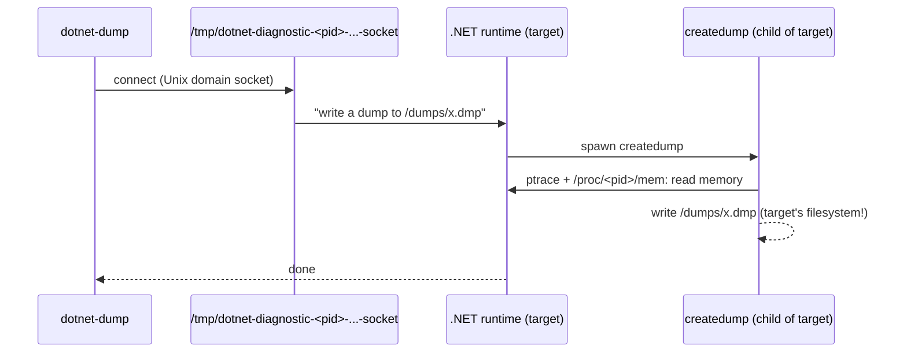

# 7. Linux and Docker

The labs already run in containers. This chapter explains *why* the commands look the way they do,
and how to apply them to your own containers.

## How `dotnet-dump` reaches a process



Consequences:

1. `dotnet-dump` must **see the socket** in the target's `/tmp` (or `$TMPDIR`).
2. It must run as the **same user** as the target (or have `CAP_SYS_PTRACE`).
3. The output path is written by `createdump` **in the target's filesystem**.
4. `createdump` uses `ptrace`; Docker's default seccomp profile allows it on kernels >= 4.8
   ([MS FAQ](https://learn.microsoft.com/en-us/dotnet/core/diagnostics/faq-dumps)).

## Option 1: tools inside the app image (the labs)

[`docker/app.Dockerfile`](https://github.com/haison8x/net-dump-tutorials/blob/main/docker/app.Dockerfile)
installs the tools in the build stage and copies them into the runtime image:

```dockerfile
RUN dotnet tool install dotnet-dump --tool-path /tools ...
FROM mcr.microsoft.com/dotnet/aspnet:10.0
COPY --from=build /tools /tools
ENV PATH="${PATH}:/tools"
USER $APP_UID
ENTRYPOINT ["sh", "-c", "exec dotnet \"$APP_DLL\" \"$@\"", "--"]
```

```bash
docker compose exec memoryleak dotnet-dump collect -p 1 -o /dumps/x.dmp
```

- `exec` in the entrypoint makes the app **PID 1**.
- `docker exec` runs as the image's `USER` - the same user as the app - so rule 2 holds.
- `/dumps` is a volume, so the file is visible on the host and in other containers.

Simple and reliable, at the cost of ~100 MB of tools in every image.

## Option 2: a sidecar container (shared PID namespace + `/tmp`)

Keep the app image clean, and attach a tools container when needed:

```yaml
# docker-compose.yml (excerpt)
  memoryleak:
    volumes:
      - ./dumps:/dumps
      - memoryleak-tmp:/tmp          # the diagnostic socket lives here
  sidecar:
    image: dumplab/tools
    pid: "service:memoryleak"        # see the app's processes
    user: "1654"                     # same UID as the app
    volumes:
      - ./dumps:/dumps
      - memoryleak-tmp:/tmp          # see the app's socket
```

```bash
docker compose run --rm sidecar dotnet-dump ps
docker compose run --rm sidecar dotnet-dump collect -p 1 --type Heap -o /dumps/sidecar.dmp
```
```text
 1  dotnet  /usr/share/dotnet/dotnet  dotnet MemoryLeak.Api.dll
Writing dump with heap to /dumps/sidecar.dmp
Complete
```

## Option 3: shared PID namespace only (`/proc/1/root/tmp`)

Often you cannot add a shared `/tmp` to a container that is already running. If you only share
the PID namespace, `dotnet-dump` finds nothing:

```bash
docker run --rm --pid=container:<app-container> dumplab/tools dotnet-dump collect -p 1 -o /dumps/x.dmp
```
```text
Unable to connect to Process 1. Please verify that /tmp/ is writable by the current user. ...
If the target process is in a different container, ensure this process runs with 'pid: host' and has
access to /proc/{pid}/root/ (requires CAP_SYS_PTRACE or privileged mode).
```

The trick: the target's filesystem is visible through `/proc/<pid>/root`. Point `TMPDIR` at the
target's `/tmp`, and run as the app's UID:

```bash
docker run --rm --pid=container:<app-container> --user 1654 -e HOME=/tmp/h \
    -e TMPDIR=/proc/1/root/tmp dumplab/tools dotnet-dump collect -p 1 -o /dumps/x.dmp
```
```text
Writing full to /dumps/x.dmp
Complete
```

(Running as root with `--cap-add SYS_PTRACE` and the same `TMPDIR` works too.) The dump is written
to `/dumps` **of the app container** - make sure that path exists there and is a volume.

## Dumps on crash in containers

Set the variables from [Chapter 2](02-collecting-dumps.md#on-crash-environment-variables) in the
image or the orchestrator, and point `DOTNET_DbgMiniDumpName` to a **volume**. Note that `%e` is
`dotnet` when the app is started as `dotnet app.dll`, so include something identifying in the path
(`%h` - the container hostname - is a good choice).

## Analyzing Linux dumps

| Where | How | Notes |
|---|---|---|
| A container with the same .NET version (the labs' `tools`) | `dotnet-dump analyze` | the DAC is found in the local runtime folder - zero setup |
| Windows/macOS host | `dotnet-dump analyze` | the DAC is downloaded from Microsoft's symbol server |
| Linux with lldb | `lldb --core <dump> <host>` + SOS | native + managed |

Microsoft recommends analyzing on the *same architecture and Linux distro* as the dump came from
([docs](https://learn.microsoft.com/en-us/dotnet/core/diagnostics/debug-linux-dumps)) - a container
built from the same base image as the app is the easiest way to get that.

### lldb + SOS

Verified in a container based on the `tools` image:

```bash
apt-get update && apt-get install -y lldb
dotnet tool install -g dotnet-sos && ~/.dotnet/tools/dotnet-sos install
lldb --core /dumps/deadlock-locks.dmp /usr/share/dotnet/dotnet
```
```text
(lldb) target create "/usr/share/dotnet/dotnet" --core "/dumps/deadlock-locks.dmp"
Core file '/dumps/deadlock-locks.dmp' (x86_64) was loaded.
(lldb) setsymbolserver -directory /symbols
(lldb) syncblk
Index         SyncBlock MonitorHeld Recursion Owning Thread Info          SyncBlock Owner
    8 000062E9F35DEDB0           13         1 0000745B90001150 27  33   0000745cb497c348 System.Object
    9 000062E9F35DEE08           13         1 0000745BAC002060 23  29   0000745cb498f3c0 System.Object
```

The second argument is the **host program** that started the app: `dotnet` for framework-dependent
apps, the app's own executable for self-contained ones. lldb needs `libcoreclr.so`,
`libmscordaccore.so` and that host from the *same* runtime version - `dotnet-symbol` can download
them, or `setclrpath <dir>` points SOS to a folder where you copied them.

## Things that bite in production containers

- **Killed for memory** - a leaking container gets killed at its memory limit, and nothing writes
  a dump for that (it is a `SIGKILL`, not a crash). Collect a dump *before* the limit: watch
  `dotnet.gc.last_collection.heap.size`, or use `dotnet-monitor` collection rules.
- **Dump size vs. disk** - a Full dump is roughly as large as the process's memory. Make sure the
  volume has room, and prefer `--type Heap`.
- **Health checks** - writing a dump freezes the process for seconds. A tight health check can
  restart the container in the middle of the dump. Relax it while you investigate.
- **Ephemeral storage** - a dump written to the container's own filesystem disappears with the
  container. Always write to a volume and copy the dump out before removing the container.

Next: [Automation with ClrMD and DumpLinq](08-automation-clrmd-dumplinq.md).
